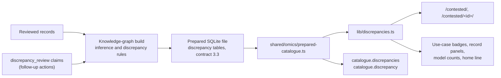

# Contested results

The site flags results where one study disagrees with what other studies report for the same models. Each flag is a finding: an automatic lead to check, not a finding of error. The data repository infers the findings and records the follow-up on each one. The site only shows them.

The rules, states, actions and IDs are described in the data repository's [docs/discrepancies.md](https://github.com/rewire-bio/rewire-benchmark-data/blob/main/docs/discrepancies.md).

## Where the data comes from

The site reads only the pinned release's SQLite file. The tables are `discrepancies`, `discrepancy_results`, `discrepancy_systems`, `discrepancy_actions`, `discrepancy_aliases` and the `discrepancy_index` blob. `lib/discrepancies.ts` wraps the readers and holds the labels for states, actions and rules.

A file older than contract 3.3 has no findings. Every reader then returns empty, `/contested/` says the release has no discrepancy data, and no marks appear.

## Pages

| Page | Shows |
| --- | --- |
| `/contested/` | Counts for the release, and the findings, most severe first, each with a one-line summary and small chart when the release has per-study data. Filters by status (open or settled), severity, state, model and use case through search parameters. The use-case filter keeps findings in which any of the use case's results takes part, in either role. |
| `/contested/<id>/` | The summary, which studies agree (when the release has per-study data), what the rule counted, the compared results in each study, the follow-up timeline, and how to help resolve the finding. An earlier ID redirects to the current one. |
| Use-case pages | A Contested badge on a row whose results are the disagreeing study's in an unsettled finding, and a link to `/contested/?use_case=<slug>` when any row has one. |
| Result and evaluation pages | A Contested panel naming each finding and whether the result is from the study that disagrees or from the agreeing group. An evaluation page covers the results it shows. |
| Model, method and configuration pages | "N open disagreements between studies involve this model", linking to the filtered list. A configuration uses its model's count, since findings compare models. |
| Home page | A "New" notice (`lib/home-notice.ts`, set to `null` to remove) and the count of open findings. |
| `/investigations/` | Findings with an investigation of our own. |

## Which studies agree

A finding's optional `studies` list has one entry per study: its role (`outlier` or `consensus`), its source records, how many of its comparisons rank each system higher, its ties, its gap for the gap rule, and its comparisons (at most 200; `comparisons_total` is the full count). One component, `components/catalogue/DisagreementView.tsx`, draws it for every finding; `lib/disagreement.ts` builds what it shows from the finding alone, so no finding has its own code.

- **Summary.** One or two sentences from the counts, for example "4 papers rank AlphaGenome above Borzoi in all 25 of their comparisons. Alavi 2026 ranks Borzoi above AlphaGenome in 9 of its 12 comparisons and AlphaGenome higher in 3." Ties, mixed papers and a single consensus paper each have their own wording. Papers are named by a short citation taken from the source record's name ("Alavi 2026"), else the shortened name, else the study key.
- **Ordering reversal.** Two overlapping circles: papers that rank A higher in every comparison that is not a tie, papers that rank B higher, and mixed papers in the overlap; papers with only ties are listed below. Then one 100% stacked bar per paper: comparisons where A scored higher, ties, and B higher, labelled with counts. A is the system the consensus ranks higher.
- **Gap outlier.** A dot per paper at its median relative gap to the reference, (system - reference) / reference, with the other papers' range shaded.
- **Table and comparisons.** Every paper with its role ("Disagrees" or "Agrees"), counts, ties and gap, then each paper's comparisons in a collapsed section with both values linked to their result pages. A capped list says "first N of M".

The paper that disagrees comes first and is outlined in every chart. Above 12 papers the charts draw the 12 with the most comparisons and say how many more are in the table; the circles show a count per group with every name in the caption. Each chart is an SVG with a title and a description that lists every value, and uses the site's colour variables.

On `/contested/` each entry with per-study data shows the compact form: the summary and one small chart (a bar for the other papers together and one for the paper that disagrees, or a single gap strip).

Releases before the per-study data have no `studies`. The section and the compact form are then left out and the pages are as before.

## Flag only

A finding never hides a result. Flagged results stay in every table, page, API answer and download. A result is withheld only when a reviewer marks it `disputed` or a source carries a scoped evidence concern.

## Follow-up timeline

Each accepted revision of a finding's `discrepancy_review` claims is one action: what was done, the state after it, the date, the rationale, links to our investigation and to the report to the authors, what we are waiting for, and the next check date.

The detail page lists the actions oldest first. Each step's heading names its main link, the report to the authors if there is one, else our investigation: `owner/repo#N` for a GitHub issue or pull request, otherwise the host name, for example "Reported to the authors · marcel-2c8/Probing-genomic-foundation-models-2026#2". Below it the step lists every link with what it is ("Issue raised with the authors", "Our investigation"), and the authors' response when one is recorded. A step has no separate date for the response, so the response text carries its own. When the latest action's next check date has passed and the finding is unsettled, the page marks it Overdue. Pages are cached at the edge for up to a week, so the browser makes this comparison (`components/catalogue/OverdueMark.tsx`). The server HTML never contains it.

## For agents

The public API has `catalogue.discrepancies` (filters: `severity`, `state`, `settled`, `system`, `rule`, `cursor`, `limit`) and `catalogue.discrepancy` (`id`). The knowledge-graph bundle holds the same findings; rdf-kg-mcp 0.2 (the pinned install) offers the named queries `open_discrepancies`, `discrepancies_for_system`, `discrepancy_history` and `contested_results_for_use_case`. `/agents/` and `/llms.txt` list both.
