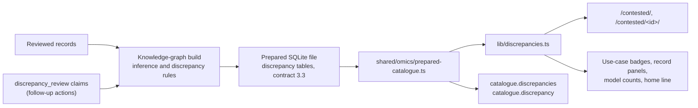

# Contested results

The site flags results where one study disagrees with what other studies report for the same models. Each flag is a finding: an automatic lead to check, not a finding of error. The data repository infers the findings and records the follow-up on each one. The site only shows them.

The rules, states, actions and IDs are described in the data repository's [docs/discrepancies.md](https://github.com/rewire-bio/rewire-benchmark-data/blob/main/docs/discrepancies.md).

## Where the data comes from

The site reads only the pinned release's SQLite file. The tables are `discrepancies`, `discrepancy_results`, `discrepancy_systems`, `discrepancy_actions`, `discrepancy_aliases` and the `discrepancy_index` blob. `lib/discrepancies.ts` wraps the readers and holds the labels for states, actions and rules.

A file older than contract 3.3 has no findings. Every reader then returns empty, `/contested/` says the release has no discrepancy data, and no marks appear.

## Pages

| Page | Shows |
| --- | --- |
| `/contested/` | Counts for the release, and the findings, most severe first. Filters by status (open or settled), severity, state and model through search parameters. |
| `/contested/<id>/` | The summary, what the rule counted, the compared results in each study, the follow-up timeline, and how to help resolve the finding. An earlier ID redirects to the current one. |
| Use-case pages | A Contested badge on a row whose results are the disagreeing study's in an unsettled finding. |
| Result and evaluation pages | A Contested panel naming each finding and whether the result is from the study that disagrees or from the agreeing group. An evaluation page covers the results it shows. |
| Model, method and configuration pages | "N open disagreements between studies involve this model", linking to the filtered list. A configuration uses its model's count, since findings compare models. |
| Home page | A "New" notice (`lib/home-notice.ts`, set to `null` to remove) and the count of open findings. |
| `/investigations/` | Findings with an investigation of our own. |

## Flag only

A finding never hides a result. Flagged results stay in every table, page, API answer and download. A result is withheld only when a reviewer marks it `disputed` or a source carries a scoped evidence concern.

## Follow-up timeline

Each accepted revision of a finding's `discrepancy_review` claims is one action: what was done, the state after it, the date, the rationale, links to our investigation and to the report to the authors, what we are waiting for, and the next check date.

The detail page lists the actions oldest first. When the latest action's next check date has passed and the finding is unsettled, the page marks it Overdue. Pages are cached at the edge for up to a week, so the browser makes this comparison (`components/catalogue/OverdueMark.tsx`). The server HTML never contains it.

## For agents

The public API has `catalogue.discrepancies` (filters: `severity`, `state`, `settled`, `system`, `rule`, `cursor`, `limit`) and `catalogue.discrepancy` (`id`). The knowledge-graph bundle holds the same findings; rdf-kg-mcp 0.2 or later offers the named queries `open_discrepancies`, `discrepancies_for_system`, `discrepancy_history` and `contested_results_for_use_case`. `/agents/` and `/llms.txt` list both.
